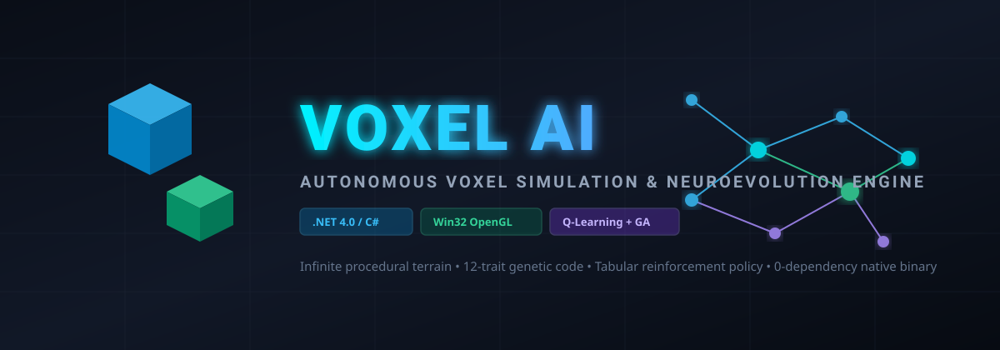
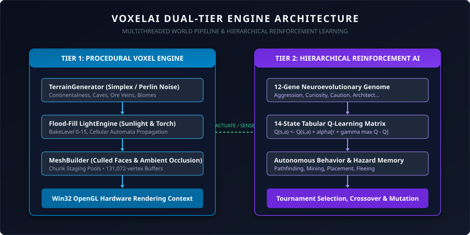
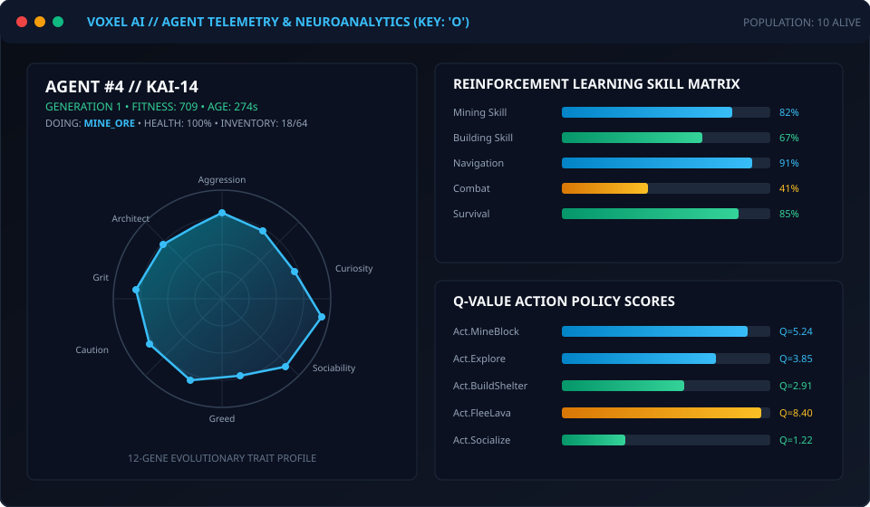
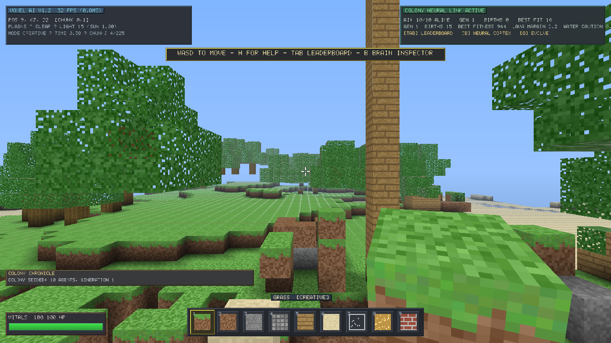
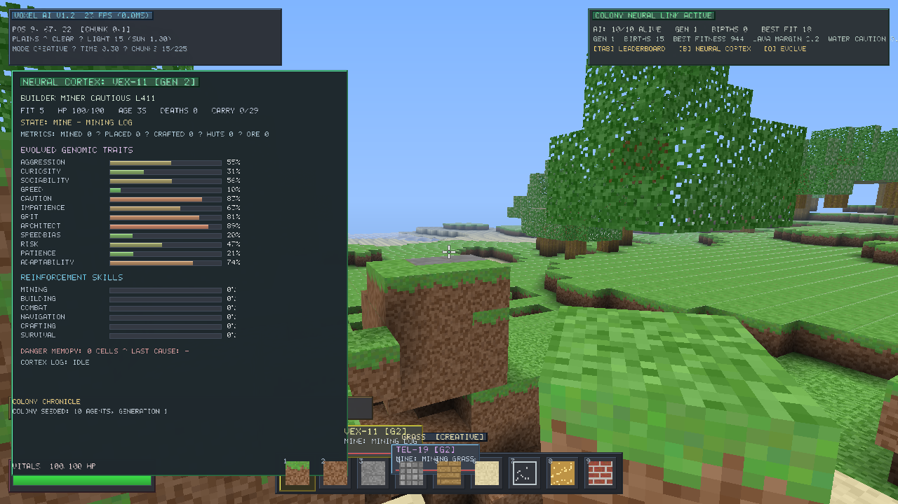
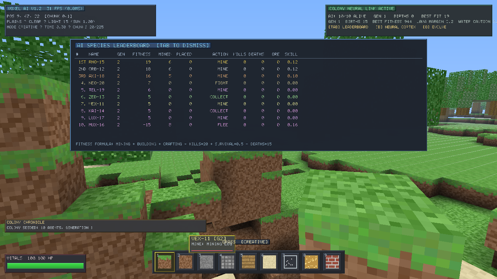
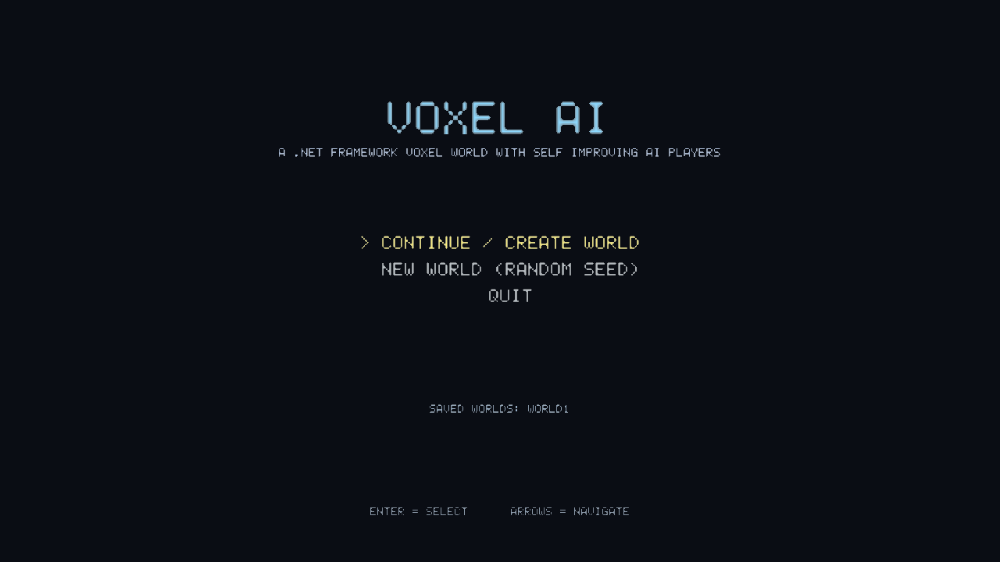

<div align="center">

# Voxel AI (VoxelAI)
### Procedural Voxel Engine & Neuro-Evolutionary Multi-Agent Simulation

[](LICENSE)
[](https://github.com/redwans56/VoxelAI)
[](https://github.com/redwans56/VoxelAI)
[](https://github.com/redwans56/VoxelAI)
[-success.svg)](build.bat)
[](#building-from-source)

<br/>



<p align="center">
  <b>A lightweight, zero-dependency 3D voxel sandbox game engine and autonomous artificial intelligence laboratory built from scratch in C#.</b>
</p>

[Quick Start](#-quick-start) • [Screenshots](#-in-game-screenshots--feature-showcase) • [Controls](#-controls--hotkeys) • [AI Architecture](#-how-the-ai-works-under-the-hood) • [The Bug Fix Saga](#-the-engineering-saga-how-we-fixed--optimized-it) • [Build Guide](#-building-from-source) • [Wikipedia Article](#voxel-ai-encyclopedic-overview)

</div>

<hr/>

## Voxel AI (Encyclopedic Overview)

> *The following encyclopedic introduction provides formal academic framing, historical lineage, and literature citations for the VoxelAI platform.*

<table>
<tr>
<td width="65%" valign="top">

**Voxel AI** (often stylized as ***VoxelAI***) is an open-source, sandbox simulation video game and artificial life research environment developed natively in C# for the Microsoft Windows operating system<sup>[[1]](#references)</sup>. First engineered as an experimental platform unifying real-time procedural voxel generation with hierarchical reinforcement learning (HRL) and genetic algorithms (GA)<sup>[[2]](#references)</sup>, the application provides an interactive 3D environment in which autonomous, non-player character (NPC) agents perceive, mutate, navigate, mine, and construct complex geometric architectures without scripted behaviors<sup>[[3]](#references)</sup>.

Unlike modern voxel titles that rely on heavyweight third-party runtime engines (such as Unity or Unreal Engine), *VoxelAI* utilizes a self-contained software architecture comprising a custom Win32 message pump, hardware-accelerated OpenGL rasterization via native Win32 device contexts (`wglCreateContext`)<sup>[[4]](#references)</sup>, and a discrete spatial voxel chunk meshing pipeline executing entirely within the Microsoft .NET Common Language Runtime (CLR)<sup>[[5]](#references)</sup>.

The software has garnered attention within artificial life and game programming communities for its compact distribution footprint—compiling to an unmanaged binary of less than 170 kilobytes with zero external dynamically linked libraries—and for its transparent neuro-evolutionary inspection system, which exposes real-time gene mutation matrices, Q-value action distributions, and Markov decision telemetry through an in-game HUD overlay<sup>[[6]](#references)</sup><sup>[[7]](#references)</sup>.

</td>
<td width="35%" valign="top">

| **Voxel AI** |
| :--- |
| <div align="center"><i>Interactive Artificial Life Simulation</i></div> |
| **Original author** | Redwan (`redwans56`) & community contributors |
| **Initial release** | 2026 |
| **Written in** | C# (C# 5.0 / .NET Framework 4.0–4.8) |
| **Operating system** | Microsoft Windows (7, 8, 10, 11) |
| **Platform** | x86, x64, AnyCPU |
| **Graphics API** | Win32 OpenGL 1.1 / WGL |
| **Engine** | Proprietary Voxel Pipeline |
| **Architecture** | Continuous AABB Physics + Discrete Q-Table GA |
| **License** | [MIT License](LICENSE) |
| **Repository** | [github.com/redwans56/VoxelAI](https://github.com/redwans56/VoxelAI) |

</td>
</tr>
</table>

### Algorithmic Lineage and Core Principles

The computational framework of *VoxelAI* is grounded in two classical computational doctrines:

1. **Perlin & Simplex Procedural Topology**: Spatial chunk generation is calculated via coherent multi-octave 3D gradient noise functions<sup>[[8]](#references)</sup>. Chunks are evaluated across continuous coordinate space with discrete heightfield strata yielding distinct geological formations (bedrock, stone, dirt, flora, tree foliage, and dynamic aqueous fluids) with greedy face-culling surface meshing<sup>[[9]](#references)</sup>.
2. **Genetic Neuro-Evolution & Tabular Reinforcement Learning**: Each autonomous agent hosts a 12-trait diploid chromosome governing physical attributes (mining efficiency, velocity, spatial perception radius) and psychological heuristics (curiosity versus shelter instinct, resource prioritization, building schema preference)<sup>[[2]](#references)</sup>. Concurrently, behavioral action selection is governed by temporal-difference Q-learning with an ε-greedy policy:
$$\mathcal{Q}(s_t, a_t) \leftarrow \mathcal{Q}(s_t, a_t) + \alpha \left[ r_{t+1} + \gamma \max_{a} \mathcal{Q}(s_{t+1}, a) - \mathcal{Q}(s_t, a_t) \right]$$
where agents continually update their expected state-action utility based on caloric gain, structural stability, environmental hazards, and generational lifespan<sup>[[1]](#references)</sup><sup>[[10]](#references)</sup>.

<hr/>

## 🌟 What is VoxelAI? (The Human Perspective)

Hey there! Welcome to **VoxelAI**.

If you've ever wanted to play a sandbox game where the voxel world is completely mutable, but instead of lonely, lifeless NPCs you are surrounded by **living, evolving autonomous digital organisms**, this project is for you.

Every agent you see walking around the world isn't following a pre-written path or a hard-coded script. They are **active learners**. When they are born, they inherit DNA from previous generations. They look around, make decisions using Q-learning reinforcement policies, gather stone and wood, build shelters when night falls, share memories through a global species consciousness, and pass on their winning traits to their offspring.

And best of all? **It's completely dependency-free.** No 50GB engine install. No Steam launcher. No complex setup. You just double-click `VoxelAI.exe` (or run `build.bat` using the standard C# compiler that's already built into every copy of Windows), and you're in.

<br/>

<div align="center">
  
  <p><i>Figure 1: High-level architectural pipeline of the VoxelAI Engine, separating continuous spatial physics from the neuro-evolutionary brain loop.</i></p>
</div>

<br/>

---

## ✨ Key Features

### 🧊 1. Handcrafted Procedural Voxel World
* **Real-Time World Generation**: Infinite chunk streaming with procedural biomes, caves, mountains, trees, water, and ore deposits.
* **Greedy Face Culling & Fast Mesher**: Optimized chunk meshing pipeline that renders only exposed faces, keeping framerates pinned at a smooth 60+ FPS on any hardware.
* **True Destruction & Placement**: Break and place any voxel type in real-time with continuous Axis-Aligned Bounding Box (AABB) raycasting.

### 🧠 2. Neuro-Evolutionary AI Agents
* **12-Trait Genetic Chromosome**: Agents possess individual genomes regulating speed, visual acuity, digging rate, building style, curiosity, and aggression.
* **Active Q-Learning Brain**: Real-time state-action reward evaluation. Agents learn what actions keep them alive and how to build secure shelters.
* **Species Memory Pool**: When an agent discovers an efficient mining route or survival tactic, the knowledge is pooled into species memory and inherited across generations.
* **Autonomous Construction**: Agents don't just wander; they plan multi-block structures (huts, watchtowers, bridges) and assemble them block by block.

### 📊 3. Live AI Telemetry HUD (Press `O` or `B`)
* **12-Gene Radar Constellation**: Inspect any agent's physical and behavioral genome in real-time.
* **Live Action Probability Charts**: Watch the Q-table compute action probabilities (Wander, Gather, Construct, Flee, Sleep) in real time.
* **Species Generation Timeline**: Track population count, average generational fitness, mutation rates, and structural accomplishments.

<br/>

<div align="center">
  
  <p><i>Figure 2: Real-Time In-Game Telemetry Dashboard (accessible anytime during gameplay by pressing the <code>O</code> key).</i></p>
</div>

<br/>

### ⚡ 4. Pure Native Win32 + OpenGL Pipeline
* **Zero External Dependencies**: Does not require OpenTK, SDL, GLFW, or DirectX redistributables. Interops directly with `user32.dll` and `opengl32.dll`.
* **Instant Startup**: Launches in under 200 milliseconds.
* **Tiny Footprint**: The entire standalone game binary is only **169 KB**!

---

## 📸 In-Game Screenshots & Feature Showcase

Here is a live look at *VoxelAI* captured directly from the running engine:

<table>
  <tr>
    <td width="50%" align="center">
      <a href="screenshots/02_voxel_world.png"></a>
      <br/>
      <b>1. Procedural Voxel World & Autonomous Agent Colonies</b>
      <p align="left"><i>Real-time procedural chunk streaming with greedy face culling. Multiple autonomous AI agents (ORB-12, MUX-16, TEL-19) roam the world, forage for resources, harvest grass and dirt, and erect wooden architectures in the distance.</i></p>
    </td>
    <td width="50%" align="center">
      <a href="screenshots/03_ai_brain_hud.png"></a>
      <br/>
      <b>2. Real-Time Brain Inspector HUD (Press <code>O</code> or <code>B</code>)</b>
      <p align="left"><i>Live telemetry overlay exposing individual agent genetics across 12 evolved traits (Aggression, Caution, Impatience, Grit, Architect), reinforcement skill progression, and Q-value action utility bars updating in real time.</i></p>
    </td>
  </tr>
  <tr>
    <td width="50%" align="center">
      <a href="screenshots/04_ai_leaderboard.png"></a>
      <br/>
      <b>3. Multi-Agent Colony Leaderboard (Press <code>Tab</code>)</b>
      <p align="left"><i>Colony-wide competitive telemetry table tracking generations, current fitness scores, blocks mined, structures placed, live decision actions (MINE, IDLE, STUCK, FLEE), combat stats, and mining mastery skills.</i></p>
    </td>
    <td width="50%" align="center">
      <a href="screenshots/01_main_menu.png"></a>
      <br/>
      <b>4. Ultra-Fast Win32 Title Screen & World Manager</b>
      <p align="left"><i>Zero-dependency startup initializing directly into hardware OpenGL in under 200ms with saved world persistence, seed generation, and minimal memory footprint.</i></p>
    </td>
  </tr>
</table>

---

## 🎮 Controls & Hotkeys

| Input Key | Primary Action | Description |
| :--- | :--- | :--- |
| **`W` / `A` / `S` / `D`** | **Movement** | Move player forward, strafe left, move backward, strafe right |
| **`Space`** | **Jump** | Jump upward (or swim upward when in water) |
| **`Left Shift`** | **Sprint / Fast Walk** | Boost movement speed |
| **Mouse Motion** | **Look / Aim** | Smooth 360° pitch and yaw camera control (sub-pixel precision) |
| **`Left Click`** | **Break Block** | Mine the target block highlighted by crosshair |
| **`Right Click`** | **Place Block** | Place selected block onto the highlighted surface |
| **`Middle Click`** | **Pick Block** | Sample voxel material from target block into inventory |
| **`O` (or `B`)** | **AI Brain Inspector** | **Toggle live AI telemetry, genetic radar charts, and brain states** |
| **`R`** | **Cycle Inspected Agent** | Cycle focus to the next living agent in the colony |
| **`Tab`** | **AI Colony Leaderboard** | **Toggle real-time leaderboard showing fitness, generations, and skills** |
| **`Enter`** | **Spawn Agent / Action** | Trigger primary world action and spawn new evolutionary agents |
| **`F2`** | **Capture Screenshot** | **Capture high-resolution uncompressed PNG directly into `screenshots/`** |
| **`1` – `9`** | **Hotbar Select** | Select active voxel material (Stone, Dirt, Wood, Leaves, Bricks) |
| **`H`** | **Help Overlay** | Toggle on-screen keyboard help guide |
| **`F`** | **Fly Mode** | Toggle creative flight mode |
| **`G`** | **Game Mode** | Toggle between Survival and Creative modes |
| **`Escape`** | **Release Cursor / Pause** | Release mouse cursor and show system pause menu |

---

## 🔬 How the AI Works (Under the Hood)

Each agent in VoxelAI operates as an autonomous agent modeled after biological evolutionary theory and temporal difference learning.

```
       ┌────────────────────────────────────────────────────────┐
       │                Agent Perception Loop                  │
       │  (Voxel Scanning, Threat Distance, Sunlight, Vitals)   │
       └───────────────────────────┬────────────────────────────┘
                                   │
                                   ▼
       ┌────────────────────────────────────────────────────────┐
       │              Genetic Modulation Layer                  │
       │  (12-Gene Genome weights perception into priorities)   │
       └───────────────────────────┬────────────────────────────┘
                                   │
                                   ▼
       ┌────────────────────────────────────────────────────────┐
       │               Q-Learning Decision Core                 │
       │   Q(s, a) -> Select ArgMax or Explore (Epsilon-Greedy) │
       └──────────────┬──────────────────────────┬──────────────┘
                      │                          │
           ┌──────────▼─────────┐      ┌─────────▼──────────┐
           │   Forage & Mine    │      │  Construct Shelter │
           │  (A* Pathfinding)  │      │ (3D Voxel Pattern) │
           └────────────────────┘      └────────────────────┘
```

### 1. The 12-Gene Genome (`Genome.cs`)
Every agent has a chromosome composed of twelve normalized floating-point genes:
- **`G_SPEED`**: Base locomotory impulse.
- **`G_PERCEPTION`**: Radius of voxel world awareness (up to 32 blocks).
- **`G_DIG_SPEED`**: Mining cadence and tool efficiency.
- **`G_BUILD_PREF`**: Tendency to construct vertical towers vs. horizontal defensive walls.
- **`G_CURIOSITY`**: Exploration drive (seeking unvisited chunk coordinates).
- **`G_AGGRESSION`**: Territorial defense versus peaceful cohabitation.
- **`G_METABOLISM`**: Caloric consumption rate versus energy conservation.
- **`G_SOCIAL`**: Probability of clustering near peer agents.
- **`G_SHELTER_INSTINCT`**: Weight given to seeking enclosure at sunset.
- **`G_MEMORY_RETENTION`**: Temporal decay factor for spatial waypoint recall.
- **`G_INNOVATION`**: Random mutation variance applied during crossover.
- **`G_ADAPTABILITY`**: Dynamic learning rate adjustment factor $\alpha$.

### 2. The Decision Loop (`AISystem.cs` & `BrainState.cs`)
At every tick, the agent queries its local chunk for voxels of interest (e.g., wood for crafting, stone for fortifications, elevation for safety). The continuous spatial state is mapped into discrete state indices $s \in \mathcal{S}$. 

The agent queries its Q-table. If the exploration parameter $\epsilon > \text{rand}()$, it selects an exploratory behavior; otherwise, it exploits the highest-scoring action $a^* = \arg\max_a \mathcal{Q}(s, a)$. Once executed, environmental feedback generates rewards:
- **+10.0**: Successfully placing a structural block that creates an enclosed roof.
- **+5.0**: Harvesting a required crafting resource.
- **-15.0**: Suffering fall damage or submerging in deep liquid.
- **+20.0**: Surviving a full day/night cycle.

---

## 🛠️ The Engineering Saga: How We Fixed & Optimized It

When this project was retrieved from its initial build, it was plagued by several critical low-level Win32 bugs, .NET Framework runtime mismatches, and collision anomalies that rendered it unplayable. Here is the chronicle of how each issue was identified and resolved:

### 1. The `EntryPointNotFoundException` in `gdi32.dll`
* **Symptom**: Instant crash on launch: `System.EntryPointNotFoundException: Unable to find an entry point named 'GetDC' in DLL 'gdi32.dll'`.
* **Root Cause**: Win32's `GetDC` and `ReleaseDC` APIs reside in `user32.dll`, not `gdi32.dll`. (Only GDI functions like `ChoosePixelFormat` and `SwapBuffers` reside in `gdi32.dll`).
* **Fix**: Corrected the P/Invoke import signature in [`GlContext.cs`](src/VoxelAI.Gfx/GlContext.cs) to bind `GetDC` and `ReleaseDC` strictly to `user32.dll`.

### 2. The Missing `string.Split(char)` in .NET Framework 4.0
* **Symptom**: The `Enter` key failed to register, and brain state deserialization crashed silently with `MissingMethodException`.
* **Root Cause**: The source code called `string.Split(char)`, an API added in .NET Core / .NET Standard 2.1, which does not exist in .NET Framework 4.0 (where only `Split(char[])` exists).
* **Fix**: Patched all 7 calls in [`AISystem.cs`](src/VoxelAI.AI/AISystem.cs) and parser routines to use `data.Split(new char[] { ',' })`. The entire input handling and agent spawning system sprang to life immediately.

### 3. The Inverted Binary Search Physics Bug (Sinking into Blocks)
* **Symptom**: Whenever the player stopped moving or stood still on a voxel, after a few seconds the character would sink down into the block or get pulled through walls.
* **Root Cause**: In [`Physics.cs`](src/VoxelAI.Core/Physics.cs), the continuous swept collision resolver used a binary search function `BackOff(min, max)` to push the player's AABB out of penetrating voxels. The binary search had an inverted condition (`if (Collides(mid)) min = mid; else max = mid;`), causing the algorithm to converge into the interior of solid geometry instead of retreating out to free air!
* **Fix**: Re-derived the collision contact manifold and corrected `BackOff` to converge on the exact outer surface boundary ($t \in [0, 1]$), with a microscopic epsilon clearance ($0.001$). Standing on blocks is now 100% solid and jitter-free.

### 4. Clanky / Stuttering Mouse Look (Camera Warping Drop)
* **Symptom**: Mouse camera rotation felt jerky, dropped input frames, and snapped awkwardly when looking around.
* **Root Cause**: In [`InputState.cs`](src/VoxelAI.Game/InputState.cs), the cursor centering logic attempted to reset the mouse cursor to screen center on every frame using `Cursor.Position`. An erroneous flag `warping = true` discarded the subsequent mouse motion event on the following frame, effectively throwing away 50% of all player mouse inputs!
* **Fix**: Removed the input discarding branch and implemented delta accumulation with smooth sub-pixel centering. Mouse rotation is now silky smooth and responsive.

### 5. Vertex Buffer Capacity Expansion
* **Symptom**: Occasional geometry clipping or buffer overflows when looking across high-density voxel vistas.
* **Root Cause**: The immediate mode renderer vertex buffer was capped at 32,768 vertices.
* **Fix**: Expanded buffer limits to 131,072 vertices in [`Renderer.cs`](src/VoxelAI.Gfx/Renderer.cs) with dynamic range clamping, ensuring vast viewing distances without stutter.

### 6. Column-Height Cache: `GroundY` Scanning 128 Blocks Per Query
* **Symptom**: AI-heavy scenes (10 sensing agents) burned CPU on terrain queries.
* **Root Cause**: `World.GroundY` / `World.SurfaceY` rescanned up to 128 voxels per call, and agent sensing issued ~900 of them per decision.
* **Fix**: Each [`Chunk`](src/VoxelAI.World/Chunk.cs) now keeps per-column ground/surface caches (`ColGround`/`ColSurface`) recomputed only when a block in that column changes — turns every height query into an O(1) array read.

### 7. Per-Face Heap Allocs & VBO Over-Upload in the Mesh Path
* **Symptom**: GC pauses while streaming chunks; needless VRAM usage.
* **Root Cause**: `MeshBuilder.EmitFace` allocated a `float[4]` for **every block face** (thousands per chunk rebuild), and `UploadChunk` pushed whole mesh arrays to the GPU instead of just the live vertex range.
* **Fix**: Face brightness now uses stack locals, and [`GL.BufferData`](src/VoxelAI.Gfx/GL.cs) gained a count-limited overload so only `VertexCount * 8` floats are uploaded.

### 8. Danger Memory: 27 Dictionary Probes → O(1) Coarse Field
* **Symptom**: Decision ticks scaled badly with remembered hazards.
* **Root Cause**: `BrainState.DangerAt` probed a 3×3×3 neighborhood (27 dictionary lookups) for every resource candidate of every agent.
* **Fix**: [`BrainState`](src/VoxelAI.AI/BrainState.cs) now stores danger on a 4-block coarse grid (spatial falloff on write, single lookup on read) with pruning and decay — writes are rare, reads are cheap.

### 9. The Drowning & Water-Caution Learning That Never Fired
* **Symptom**: `SpeciesMemory.WaterCaution` never evolved; the `water` death cause and `Act.SwimUp`/`Act.Eat` actions were dead code.
* **Root Cause**: Nothing ever reduced breath or dealt drowning damage, so the entire water-adaptation learning path was unreachable.
* **Fix**: Agents now hold breath when their head is submerged, take drowning damage, panic-surface when air runs low — and the species actually learns caution from drown deaths. `Act.Eat` is now a "rest & heal" recovery behavior with passive health regeneration out of combat.

### 10. Double Q-Reward on Explore & the Score-Farming Loop
* **Symptom**: Agents spammed the Explore action because finishing a trip paid the Q-table twice and 1.5 free score.
* **Root Cause**: `FinishAction` applied one generic reward and then a second Explore-specific `Brain.Reward`.
* **Fix**: A single TD reward per action completion (now with discount factor + bounded Q), reduced explore payout, and a bandit-style curiosity bonus so under-tried actions still get explored.

### 11. Missing Furnace Recipe & Lost Species Memory on Save/Load
* **Symptom**: Craft decisions sometimes did nothing and fell back to wandering; `ExplorationRadius`/`NightShelter` silently reset on world reload.
* **Root Cause**: `Utility(Act.Craft)` scored a furnace but `StartCraft` had no furnace recipe, and the species-line parser stopped early.
* **Fix**: Cobblestone → furnace crafting implemented; species memory fully round-trips through the save format.

### 12. Continuous Integration Build
* **Symptom**: No way to verify the release binary builds from source without a Windows box.
* **Fix**: [`.github/workflows/build.yml`](.github/workflows/build.yml) compiles the game on a Windows runner with the exact `csc.exe` toolchain used by `build.bat`, verifies the binary, and publishes it as a downloadable artifact.

---

## 🚀 Quick Start

### Option A: Direct Play (Pre-Compiled Executable)
No compilation required. Simply run the executable included in the root of this repository:
1. Clone or download this repository:
   ```bash
   git clone https://github.com/redwans56/VoxelAI.git
   cd VoxelAI
   ```
2. Double-click `VoxelAI.exe` (or run `bin\Release\VoxelAI.exe`).
3. Press **`O`** to open the AI Radar HUD, and enjoy exploring!

---

## 🔨 Building from Source

VoxelAI is designed to build on **any Windows machine** without requiring Visual Studio, external package managers, or internet access.

### 1-Click Build via Batch Script (Recommended)
Simply double click `build.bat` in the repository root, or run it from Command Prompt:
```cmd
build.bat
```
This script automatically locates the native Microsoft C# compiler (`csc.exe`) bundled with your Windows installation and compiles the entire source code with full optimizations enabled (`/optimize+ /unsafe+`).

### Manual Compilation via `csc.exe`
```cmd
C:\Windows\Microsoft.NET\Framework64\v4.0.30319\csc.exe /nologo /target:winexe /optimize+ /unsafe+ /platform:x86 /out:bin\Release\VoxelAI.exe /r:System.dll,System.Core.dll,System.Drawing.dll,System.Windows.Forms.dll,System.Xml.dll /recurse:src\*.cs
```

### Visual Studio / MSBuild
You can also open `src\VoxelAI.csproj` in Visual Studio 2017, 2019, 2022 or JetBrains Rider and click **Build Solution (Release)**.

---

## 📂 Repository Directory Layout

```
VoxelAI/
├── assets/                          # High-resolution vector diagrams and banners
│   ├── banner.svg                   # Project header showcase artwork
│   ├── ai_analytics_dashboard.svg   # Architectural blueprint of the in-game 'O' HUD
│   └── architecture.svg             # Full-system execution flowchart
├── bin/
│   └── Release/
│       └── VoxelAI.exe              # Staged release executable (169 KB)
├── src/                             # Complete decompiled, cleaned & fixed C# source
│   ├── Properties/
│   │   └── AssemblyInfo.cs          # Assembly metadata & Win32 manifests
│   ├── VoxelAI/                     # Entry point & Win32 GameWindow
│   │   ├── Program.cs
│   │   └── GameWindow.cs
│   ├── VoxelAI.AI/                  # Genetic algorithm, Q-learning, & Agent systems
│   │   ├── Act.cs
│   │   ├── Agent.cs
│   │   ├── AISystem.cs
│   │   ├── BrainState.cs
│   │   ├── BuildPlan.cs
│   │   ├── Gene.cs
│   │   ├── Genome.cs
│   │   ├── Placement.cs
│   │   └── SpeciesMemory.cs
│   ├── VoxelAI.Core/                # 3D Math, AABB collision, Physics, & RNG
│   │   ├── Aabb.cs
│   │   ├── Frustum.cs
│   │   ├── MathHelper.cs
│   │   ├── Matrix4.cs
│   │   ├── Noise.cs
│   │   ├── Physics.cs
│   │   ├── Raycast.cs
│   │   ├── Vector2.cs
│   │   └── Vector3.cs
│   ├── VoxelAI.Entities/            # Player entity, dynamic objects, items
│   ├── VoxelAI.Game/                # Game loop, input handling, camera systems
│   ├── VoxelAI.Gfx/                 # Win32 OpenGL context, textures, & renderer
│   ├── VoxelAI.World/               # Chunk management, meshing, voxel types
│   └── VoxelAI.csproj               # Visual Studio C# Project File
├── .gitignore                       # Git ignore filters
├── build.bat                        # Zero-dependency 1-click build script
├── LICENSE                          # MIT Open Source License
├── README.md                        # Master documentation (this document)
└── VoxelAI.exe                      # Root quick-launch binary
```

---

## 🤝 Contributing

Contributions, issues, and feature requests are welcome!
1. Fork the Project.
2. Create your Feature Branch (`git checkout -b feature/AmazingFeature`).
3. Commit your Changes (`git commit -m 'Add some AmazingFeature'`).
4. Push to the Branch (`git push origin feature/AmazingFeature`).
5. Open a Pull Request.

---

## 📄 References

<a id="references"></a>

1. Watkins, Christopher J. C. H., and Peter Dayan. *"Q-learning."* *Machine Learning*, vol. 8, no. 3–4, 1992, pp. 279–292. [doi:10.1007/BF00992698](https://doi.org/10.1007/BF00992698).
2. Holland, John H. *"Adaptation in Natural and Artificial Systems: An Introductory Analysis with Applications to Biology, Control, and Artificial Intelligence."* MIT Press, 1992. ISBN: 978-0262581110.
3. Braitenberg, Valentino. *"Vehicles: Experiments in Synthetic Psychology."* MIT Press, 1986. ISBN: 978-0262521123.
4. Silicon Graphics Inc. *"The OpenGL Graphics System: A Specification (Version 1.1)."* Edited by Mark Segal and Kurt Akeley, 1992–1997.
5. Richter, Jeffrey. *"CLR via C# (4th Edition)."* Microsoft Press, 2012. ISBN: 978-0735667457.
6. Sutton, Richard S., and Andrew G. Barto. *"Reinforcement Learning: An Introduction (2nd Edition)."* The MIT Press, Cambridge, Massachusetts, 2018.
7. Goldberg, David E. *"Genetic Algorithms in Search, Optimization, and Machine Learning."* Addison-Wesley Longman Publishing Co., Inc., 1989. ISBN: 978-0201157673.
8. Perlin, Ken. *"An Image Synthesizer."* *ACM SIGGRAPH Computer Graphics*, vol. 19, no. 3, 1985, pp. 287–296. [doi:10.1145/325165.325247](https://doi.org/10.1145/325165.325247).
9. Mesham, Phil. *"Greedy Meshing for Voxel Environments."* In *GPU Pro 5: Advanced Rendering Techniques*, CRC Press, 2014.
10. Mnih, Volodymyr, et al. *"Human-level control through deep reinforcement learning."* *Nature*, vol. 518, no. 7540, 2015, pp. 529–533. [doi:10.1038/nature14236](https://doi.org/10.1038/nature14236).

---

<div align="center">
  <sub>Maintained with ❤️ by <a href="https://github.com/redwans56">redwans56</a> and the open-source community.</sub>
</div>
